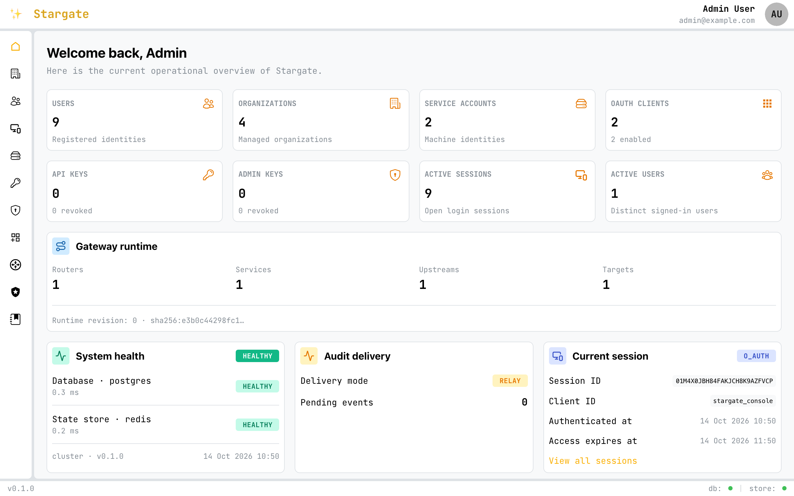
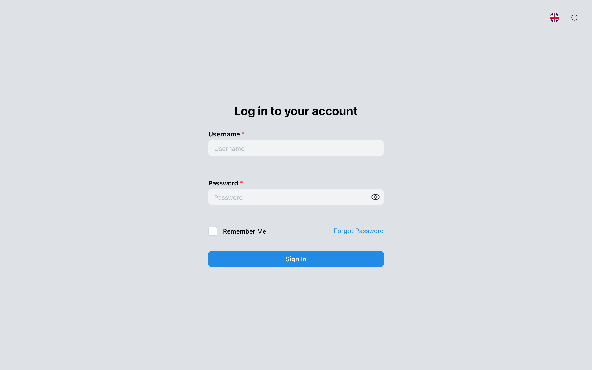

# Stargate

**Identity provider and API gateway in one Rust binary.** Access policies are
evaluated inside the gateway process, so authorizing a request needs no extra
network hop to an auth service.

[](#project-status)
[](https://github.com/alessioforte/stargate/actions/workflows/ci.yml)
[](docs/oidc-conformance.md)
[-blue)](#license)

<table>
  <tr>
    <td width="50%"></td>
    <td width="50%"></td>
  </tr>
  <tr>
    <td align="center">Console</td>
    <td align="center">Hosted login</td>
  </tr>
</table>

Stargate manages users, organizations, sessions, and API keys; acts as an
OAuth 2.0 and OpenID Connect provider; and routes traffic to your services with
rate limiting, load balancing, and failover. It ships with a web Console and a
hosted login UI, and runs as a single node on SQLite or as a horizontally
scaled cluster on PostgreSQL and Redis.

> **Free to self-host.** Stargate is source-available under the
> [Elastic License 2.0](#license): you can run, modify, and use it in production
> for your own products at no cost. You may not offer Stargate itself as a
> hosted or managed service. ELv2 is not an OSI-approved open-source license.

## Quickstart

With Docker and a clone of this repository, two commands start Stargate with
PostgreSQL, Redis, a mail catcher, and a demo upstream:

```bash
git clone https://github.com/alessioforte/stargate.git && cd stargate

docker compose up -d --wait
docker compose exec stargate /bin/server admin bootstrap \
  --email admin@example.com --generate-password
```

Open <http://localhost:5050/stargate> and sign in as `admin@example.com` with
the printed password.

The example gateway config routes `/demo` to a
[whoami](https://github.com/traefik/whoami) container, for authenticated
callers only:

```bash
curl -i http://localhost:5050/demo
# 401: anonymous requests stop at the gateway

TOKEN=$(curl -s http://localhost:5050/account/login \
  -H 'content-type: application/json' \
  -d '{"username":"admin@example.com","password":"<printed password>"}' | jq -r .accessToken)
curl http://localhost:5050/demo -H "Authorization: Bearer $TOKEN"
# 200: proxied to whoami
```

Signup, password-reset, and OTP emails land in Mailpit at
<http://localhost:8025>. Edit routes from the Console's gateway page, or start
from [`examples/quickstart/config.yaml`](examples/quickstart/config.yaml).
`docker compose down` stops everything; add `-v` to delete the data.

The quickstart uses placeholder secrets and listens on `127.0.0.1` only. For
real deployments, see [Deploy](#deploy).

## Why Stargate

Most stacks run an identity provider and a separate API gateway, then connect
them with token validation in every service, forward-auth hops, or calls to a
policy service. Stargate puts both in one process. The gateway sees the same
verified identity and organization context as the IAM layer and evaluates
access policies against in-memory rules with a local decision cache, before a
request reaches your services.

Your services keep domain checks, such as whether an order belongs to the
active organization. They no longer need to reimplement authentication, coarse
authorization, and rate limiting.

## How it compares

|                                     | Stargate                                                     | Keycloak                                                        | authentik                                  | Zitadel                                    |
| ----------------------------------- | ------------------------------------------------------------ | --------------------------------------------------------------- | ------------------------------------------ | ------------------------------------------ |
| Language                            | Rust                                                         | Java (Quarkus)                                                  | Python, Go                                 | Go, TypeScript (login UI)                  |
| License                             | ELv2 (source-available)                                      | Apache 2.0                                                      | MIT, plus enterprise license               | AGPL-3.0 (v3+)                             |
| OAuth 2.0 / OpenID Connect provider | ✅                                                           | ✅                                                              | ✅                                         | ✅                                         |
| SAML 2.0                            | ❌                                                           | ✅                                                              | ✅                                         | ✅                                         |
| Built-in API gateway                | ✅ Routing, load balancing, rate limits, failover, mirroring | ❌                                                              | Auth proxy outposts, no traffic management | ❌                                         |
| Where route authorization runs      | In the gateway process                                       | A separate gateway or adapter, or Keycloak's Authorization Services | An authentik outpost in front of each app  | Your gateway or service, from token claims |
| Smallest deployment                 | One binary + SQLite                                          | JVM server + external database                                  | Server + worker + PostgreSQL               | Server + login UI + PostgreSQL             |
| Maturity                            | Alpha                                                        | Production-proven                                               | Production-proven                          | Production-proven                          |

Choose Keycloak, authentik, or Zitadel if you need SAML, LDAP, OIDC logout, or
a mature and audited identity provider today. Comparison as
of October 2026, from each project's public documentation; corrections are
welcome.

## Features

**Identity and access**

- Users, organizations with roles, service accounts, API keys, and admin keys.
- Password login with Argon2id, configurable password policies (global and
  per organization), passwordless email OTP, and email MFA with admin step-up.
- Social login with Google and GitHub.
- Per-deployment switches for who may sign up (open, invite-only, or
  administrators only), passwordless login, and the Console. See
  [Features](docs/features.md).
- Attribute-based access-control rules, editable from the Console.
- Audit events written in the same transaction as each change; cluster
  deployments relay them to Redis Streams.

**OAuth 2.0 and OpenID Connect provider**

- Authorization Code with PKCE, client credentials, and rotating refresh tokens.
- The authorization endpoint signs users in on the hosted login page, with
  email MFA; the page is prerendered and also works without JavaScript.
- A consent page for third-party apps; users can list and revoke consents.
- Discovery, JWKS, userinfo, introspection, and revocation endpoints.
- The OpenID Foundation Basic OP and Config OP conformance plans run in CI
  (local suite, not certified).
- Admin-managed clients. See the [provider guide](docs/oauth-oidc-provider-guide.md)
  and [conformance status](docs/oidc-conformance.md).

**Gateway**

- Matching on method, host, path (exact, prefix, template, regex), headers,
  query, cookies, and source IP, with `all`/`any`/`not` combinators.
- Path rewriting, header transforms, and host preservation.
- Per-route auth, access-control, rate-limit, and quota policies, scoped to the
  subject or the organization.
- Weighted splits, traffic mirroring, failover, direct responses, health checks
  with circuit breaking, and WebSocket proxying.
- Signed identity context forwarded to upstreams, and config hot reload that
  keeps the previous version if the new one is invalid.

**Operations**

- `edge` profile (SQLite + in-memory store) and `cluster` profile (PostgreSQL +
  Redis), selected at build time.
- Liveness and readiness probes, OpenTelemetry traces, metrics, and logs, and
  graceful shutdown.
- Container images for `linux/amd64` and `linux/arm64`, and a Helm chart.

## Deploy

| Profile   | Backends                 | Use it for                                                          |
| --------- | ------------------------ | ------------------------------------------------------------------- |
| `edge`    | SQLite + in-memory store | One node: appliances, Raspberry Pi, small installs. Keep 1 replica. |
| `cluster` | PostgreSQL + Redis       | Multiple replicas behind a load balancer.                           |

- [Docker](docs/docker.md): build images and run them without Compose.
- [Helm chart](k8s/stargate/README.md): values, security defaults, and
  production examples.
- [Kubernetes with Terraform](docs/terraform-kubernetes-deployment.md), using
  existing PostgreSQL and Redis.
- [CLI](docs/cli.md): bootstrap the first administrator and generate key
  material.

Build from source with exactly one profile:

```bash
cargo run --features edge
cargo build --release --features cluster
```

## Documentation

| Guide                                                                   | Covers                                                          |
| ----------------------------------------------------------------------- | --------------------------------------------------------------- |
| [Gateway config](docs/config-v1.md)                                     | Routers, services, middlewares, policies, limits, replay rules  |
| [OAuth/OIDC provider](docs/oauth-oidc-provider-guide.md)                | Clients, flows, scopes, and claims                              |
| [OIDC conformance](docs/oidc-conformance.md)                            | What the conformance suite checks in CI, and known gaps         |
| [Features](docs/features.md)                                            | Sign-up modes, passwordless and social sign-in, the Console     |
| [Multi-organization](docs/multi-org-guide.md)                           | Organizations, memberships, and org-scoped sessions and limits  |
| [Password policies](docs/password-policies-guide.md)                    | Policy rules, per-org overrides, and hashing parameters         |
| [Internal context](docs/internal-context-consumer-guide.md)             | Verifying the identity context forwarded to upstreams           |
| [Health probes](docs/health-probes.md)                                  | Liveness, readiness, and shutdown timing                        |
| [API errors](docs/api-errors-and-messages.md)                           | Error codes and response format                                 |
| [Releasing](docs/RELEASING.md)                                          | Publishing images and the Helm chart                            |
| [`.env.example`](.env.example)                                          | Every environment variable                                      |

The OpenAPI document is served at `/docs` on a running instance.

## Project status

Stargate is **alpha**. It has not had an independent security audit, and the
configuration format and APIs may change between minor versions. Try it,
evaluate it, and report what breaks. Please be careful before putting it in
front of production traffic.

## Security

Please report vulnerabilities privately, as described in
[SECURITY.md](SECURITY.md). Do not open public issues for security problems.

## License

Copyright (c) 2024-2026 Alessio Forte.

Stargate is source-available under the [Elastic License 2.0 (ELv2)](LICENSE).

- **You can** self-host Stargate, use it commercially in your own products and
  infrastructure, modify it, and redistribute it.
- **You cannot** provide Stargate to third parties as a hosted or managed
  service that gives them access to a substantial set of its features, or
  remove its licensing notices.

ELv2 is not an [OSI-approved](https://opensource.org/licenses) open-source
license. For a managed-service offering, contact
[Alessio Forte](mailto:fortealessio@gmail.com) about a commercial license.

Third-party dependencies and incorporated components keep their own licenses
and notices. This summary is informational; the [license text](LICENSE)
governs use of Stargate.
